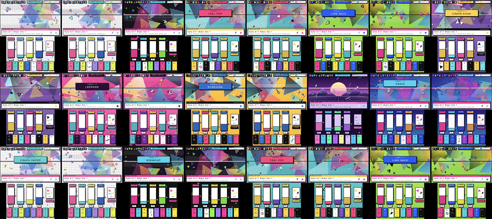

# Vibe Machine

**A pocket synth and groovebox for the Nintendo 3DS** (homebrew). The
long-term goal is a playful portable instrument with a handful of synth
engines, a drum sampler, sequencers, a 4-track tape recorder and lively
animated graphics, built to fit the original 3DS.

> **Status: early prototype.** It plays 256 Juno-6 and DX7 patches from
> the buttons and touchscreen, with chords, drums, four effect sliders, a
> live waveform and a DSP load meter, plus a 16-step sequencer with live
> recording. No tape recorder yet.

**The look:** loud 90s Memphis. Nine themes (Prism, Graph Paper,
Midnight, Teal Pop, Lime Rave, Grape Soda, Leopard, Sunshine and Vapor
Sunset): layered see-through triangles, squiggles, bolts, halftone and
striped shapes with hard drop shadows, and a burst of them on every note.
Tap **THEME** on the touchscreen to switch. Turn up the **3D slider**: the
back layers sink into the screen and the note bursts fly out of it.



Sound comes from [AMY](https://github.com/shorepine/amy), a fixed-point
synthesis library (MIT) that also runs on the ESP32 and RP2040.

## Controls

| Input | Action |
|---|---|
| D-pad ← ↓ → ↑, then Y B A X | Eight keys: C major scale, C to C |
| Hold **L** | Chord mode: each key plays its diatonic triad |
| Hold **R** | Drum mode: kick, snare, hats, clap, rim, tom, crash |
| Circle pad ← / → | Previous / next patch (hold to scroll) |
| Circle pad ↑ / ↓ | Octave up / down |
| SELECT | Jump between the Juno (0–127) and DX7 (128–255) banks |
| Touch sliders | TONE (tilt EQ), ECHO, VERB (reverb), VOL |
| Touch keys | Play (slide across keys to glide) |
| Touch THEME | Next colour theme |
| START | Play / stop the sequencer (hold START to quit) |
| Touch SOUND / SEQ tabs | Switch bottom-screen page |
| SEQ page: tap or drag cells | Paint steps (the synth row uses the last notes you played) |
| SEQ page: ▶ ● − BPM + CLR | Play/stop, arm recording, tempo, clear |

## Running it

### In the Azahar emulator (easiest)

1. Download `vibe-machine.3dsx` from the latest
   [Actions build](../../actions) (or a release), or build it yourself.
2. Azahar emulates the DSP but still needs a firmware file to exist on its
   virtual SD card. Create an **emulator-only** placeholder once:
   ```sh
   sh tools/azahar-sd-setup.sh
   ```
   Without it the app runs silently and shows "NO AUDIO".
3. Open `vibe-machine.3dsx` in Azahar (File → Load File).

The LOAD meter measures render time against real time. In the emulator it
isn't meaningful; only a real console gives a true figure.

### On a 3DS

Needs custom firmware (Luma3DS) and the Homebrew Launcher. Copy
`vibe-machine.3dsx` to `sdmc:/3ds/`. Sound needs the console's DSP firmware
at `sdmc:/3ds/dspfirm.cdc`; run the **DSP1** homebrew once to dump it from
your own console. Do not use the emulator placeholder on real hardware.

## Building

Requires [devkitPro](https://devkitpro.org/wiki/Getting_Started) with the
3DS packages:

```sh
sudo dkp-pacman -S 3ds-dev
git clone --recursive https://github.com/noble1911/vibe-machine.git
cd vibe-machine
make
```

CI builds every push with the `devkitpro/devkitarm` container
([workflow](.github/workflows/build.yml)); pushing a `v*` tag publishes a
release.

## Layout

| Path | What |
|---|---|
| `source/main.c` | Frame loop; buttons and touch → notes and parameters |
| `source/engine.c` | Thread-safe wrapper around AMY (the only file that talks to AMY) |
| `source/audio_out.c` | ndsp streaming on a dedicated audio thread, load and scope stats |
| `source/music.c` | Scales, chords and the drum map (pure logic) |
| `source/seq.c` | 16-step sequencer; its clock runs on the audio thread |
| `source/ui*.c` | Both screens (`ui_top.c`, `ui_bottom.c`), touch layout, text |
| `source/shapes.c`, `motif.c`, `theme.c` | Memphis drawing primitives, motifs and the theme table |
| `source/amy_platform_3ds.c` | Platform hooks AMY expects |
| `source/patch_names.h` | Generated by `tools/gen_patch_names.py` |
| `third_party/amy` | AMY, pinned as a git submodule |

## Credits and licence

Vibe Machine is MIT licensed (see [LICENSE](LICENSE)). It bundles
[AMY](https://github.com/shorepine/amy) by Brian Whitman and contributors,
also MIT; see [THIRD_PARTY_NOTICES.md](THIRD_PARTY_NOTICES.md).

This is an independent homebrew project, not affiliated with or endorsed by
Nintendo or any synthesizer maker. Patch names refer to the factory
patches AMY recreates.
