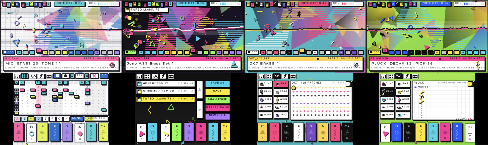
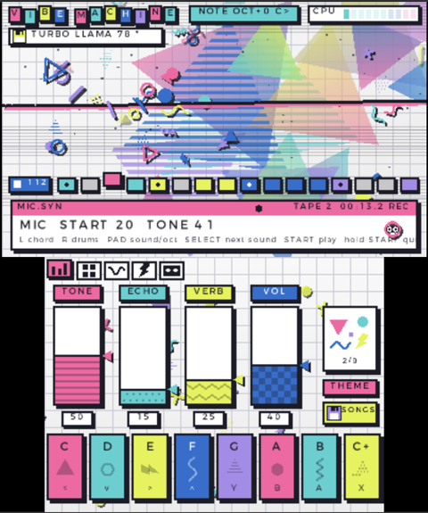
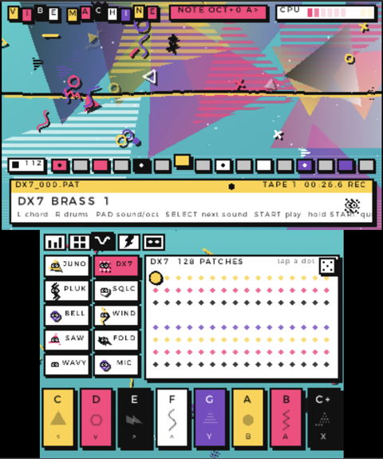
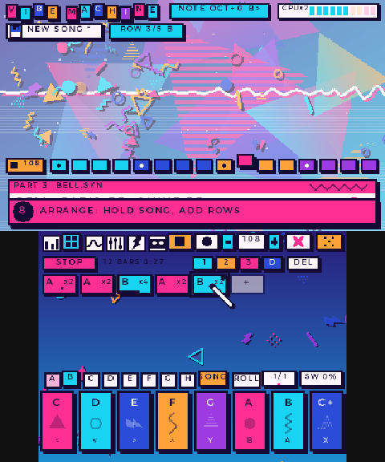
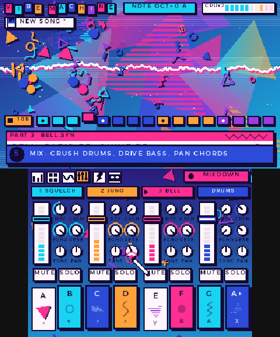
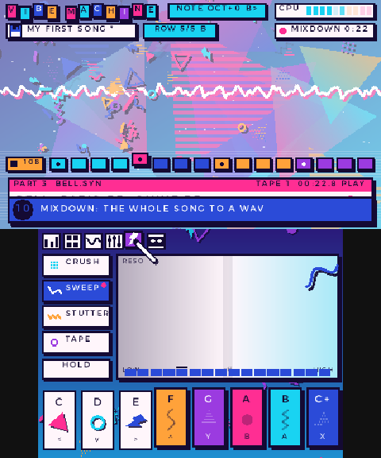
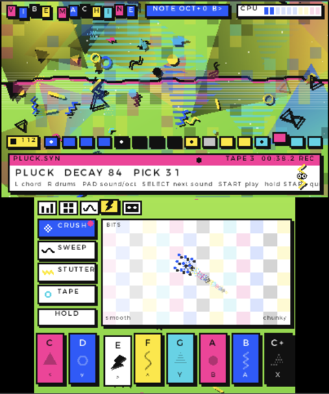
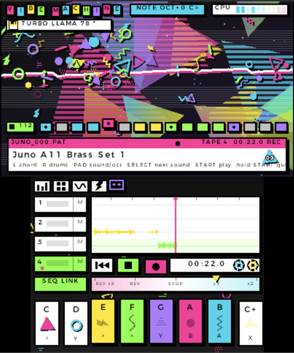

# Vibe Machine

**A loud, 90s-Memphis pocket synth and groovebox for the Nintendo 3DS** (homebrew).

Three instrument parts plus drums, eight original synth engines plus the
Juno-6 and DX7 banks, a sampler (microphone, tape or WAV; trim it, chop it
into slices across the keys), a 16-step sequencer and piano
roll with 8 pattern slots and song mode, a mixer with drive, crush, tone
and pan on every part, four performance effects you play with the stylus,
and a 4-track tape recorder,
all on an original 3DS, with stereoscopic 3D visuals that dance to what you
play.



## From nothing to a finished song

[](docs/media/zero-to-song.mp4)

**[▶ Watch the full video, with sound](docs/media/zero-to-song.mp4)** (2½
minutes). That's the app playing itself: the story build (`make STORY=1`)
taps and drags through the real touchscreen code, and ends with the song
mixed down to a WAV. The ten steps are written out in the
[tutorial](docs/TUTORIAL.md#from-nothing-to-a-finished-song).

> **New here? Read the [tutorial](docs/TUTORIAL.md).** It walks through
> every screen and has recipes for your first beat, your first tape track
> and sampling your own voice.

## What's in it

| | |
|---|---|
|  | **SOUND**: tone, echo, reverb and volume, nine colour themes, and the SONGS browser. |
|  | **SEQ**: a 16-step sequencer with a synth row, accents and eight drum lanes, plus a **piano roll** for melodies, chords and long notes. Eight pattern slots (A–H) chain into a song. Swing, live recording, and a dice that rolls new grooves. |
|  | **SYNTH**: ten sounds, each with a googly-eyed mascot. Drag the mascot around the pad to play its two macros. |
|  | The **Juno-6** and **DX7** banks: 128 patches each, as dots to tap or slide across. |
|  | **SONG sheet**: arrange patterns into a song: rows of slots, repeated ×1–8, with parts dropped out for intros and breakdowns, and an ending. |
|  | **MIX**: a channel strip for each part and the drums: fader, LED meter, DRIVE, CRUSH, TONE and PAN knobs, MUTE and SOLO. **MIXDOWN** records the finished song to a stereo WAV. |
|  | **FX**: CRUSH, SWEEP, STUTTER and TAPE STOP, played on an XY pad. HOLD lets them stack. |
|  | Record your FX moves into a pattern and it plays them back: the strip along the pad shows which steps have one. |
|  | The top screen reacts to the effects: it pixelates, freezes, glitches and slows down with the tape. |
|  | **TAPE**: four 60-second tracks that record everything, or one part or the drums at a time (which then mute live, so you hear them once). Scratch the tape, play it in reverse, vary its speed. |
|  | **SONGS**: save, load and manage named songs, with tapes and MIC takes included. |

## Quick start

1. **Get the app:** download `vibe-machine.3dsx` from the latest
   [Actions build](../../actions) (or a release), or build it (below).
2. **Run it:**
   - **Azahar emulator:** run `sh tools/azahar-sd-setup.sh` once (it gives
     Azahar's DSP emulation the file it expects), then File → Load File.
   - **3DS with custom firmware (Luma3DS):** copy the `.3dsx` to
     `sdmc:/3ds/` and start it from the Homebrew Launcher. For sound, run the
     **DSP1** homebrew once to dump your console's DSP firmware.
3. **Play:** D-pad and Y B A X are the keys. Press **START** and the
   starter beat plays. Then follow the [tutorial](docs/TUTORIAL.md).

## Controls at a glance

| Input | Does |
|---|---|
| D-pad ← ↓ → ↑, Y B A X | Eight keys, C major: C D E F, then G A B C |
| hold **L** / hold **R** | Chords / drums on those keys |
| Circle pad ↑ ↓ | Octave (−3 to +3) |
| Circle pad ← → | Next / previous patch in a bank, or sound |
| **SELECT** | Next sound |
| **START** | Play / stop the sequencer. **Hold** to quit |
| Touchscreen | Everything else: six tabs (sliders, steps, wave, faders, bolt, cassette) and the keys along the bottom |
| 3D slider | The top-screen scene in real stereoscopic depth |

The [tutorial](docs/TUTORIAL.md) explains every page in detail.

## Saving

- **Named songs** go in `sdmc:/3ds/vibe-machine/songs/<NAME>/`: `song.vms`
  (all 8 patterns, song mode, swing, tempo, each part's sound and macros,
  the mixer, sliders, theme, FX) plus `tape1.wav`…`tape4.wav` and `mic.wav`.
- **Autosave:** whatever you're working on is also saved as you go, and is
  there again next time you start.
- **Mixdowns** (MIX → MIXDOWN) go in `sdmc:/3ds/vibe-machine/mixes/`:
  the whole song, stereo, 44.1 kHz, as you heard it.
- **Samples** live in `sdmc:/3ds/vibe-machine/samples/`; copy your own WAVs
  in there too.
- The WAVs are ordinary files: copy them off the SD card into any audio
  editor.

## Building

Requires [devkitPro](https://devkitpro.org/wiki/Getting_Started) with the
3DS packages:

```sh
sudo dkp-pacman -S 3ds-dev
git clone --recursive https://github.com/noble1911/vibe-machine.git
cd vibe-machine
make            # -> vibe-machine.3dsx
make DEMO=1     # a silent attract mode that tours every page (for screenshots)
make STORY=1    # plays the zero-to-song story by itself (an end-to-end UI test)
```

The demo video is the story recording itself: `make STORY=1 RECORD=1`, run
it in Azahar until `sdmc:/3ds/vibe-machine-story/record/done` appears, then
`sh tools/make-video.sh <that folder> docs/media`. `tests/build/inspect_song`
prints what a saved song holds (`make -C tests build/inspect_song`).

### Tests

The audio can't be listened to in CI, so it's measured instead.
`make -C tests` builds the synth engine (AMY) natively on your computer and
runs seven probes:

| Probe | Checks |
|---|---|
| sound | Every sound makes a note, at a matched level, and both of its macros audibly change it; chopped samples play the right slice on each key |
| fx | Bypass is bit-exact; sweep darkens and brightens; crush quantises; stutter repeats at exactly the tempo-synced length; tape stops and recovers |
| seq | 16ths land on time, to the sample; swing gaps are right; accents hit harder; a queued pattern switches on the bar line; song mode chains the right slots; piano-roll notes hold for their length (over the bar line too), chords sound together, live notes keep the length you held; muted parts and drums stay silent |
| tape | Playback at pitch, an octave up at 2×, reverse, mute, wipe; a track set to one strip records just that strip |
| logic | Save files, WAV files, dice grooves (always in key), MIC take tidying, sample START/END and slices, resampling |
| songs | Song names, listing (sorted, hundreds of songs), save, load, overwrite, delete; the sample library's listing |
| dual | AMY's oscillators split between two threads at a voice boundary render exactly (bit for bit) what one thread does |
| mix | Each part reaches only its own strip; level, mute and pan are exact; DRIVE squares the wave off and CRUSH steps it while the level stays within a few dB; another strip's effects leave a part bit-for-bit alone; the master echo still reaches every part |

CI builds the app in the `devkitpro/devkitarm` container and runs every
probe on each push ([workflow](.github/workflows/build.yml)). Pushing a
`v*` tag publishes a release.

## How it's put together

| Path | What |
|---|---|
| `source/main.c` | Frame loop; buttons and touch → notes, sequencer, tape, songs |
| `source/engine.c` | Thread-safe wrapper around AMY; renders each block on both CPU cores (`amy_split.c`) |
| `source/audio_out.c` | Audio thread: sequencer clock → AMY (parts → mixer → master) → FX → tape → DSP |
| `source/sounds.c` | The synth engines: AMY patch strings + two macros each |
| `source/seq.c` | Sequencer: slots, song, swing, accents; clock runs on the audio thread |
| `source/mixer.c` | MIX strips: one AMY bus per part, DRIVE / CRUSH / level / pan in AMY's bus hook, summed into a master bus |
| `source/fx.c`, `tape.c` | Performance FX and the 4-track tape |
| `source/mic.c`, `sampler.c`, `samples.c` | Microphone capture; take tidying, START/END, CHOP slices, resampling; the sample library |
| `source/songs.c`, `storage.c`, `wav.c` | Named songs, the save format, WAV files |
| `source/dice.c` | Weighted random grooves |
| `source/ui*.c`, `shapes.c`, `motif.c`, `theme.c` | Both screens, the Memphis drawing kit, the nine themes |
| `source/main.c` (`VM_STORY`) | The scripted story: fake stylus and buttons through the real handlers |
| `tools/` | `make-video.sh` (story recording to MP4), `record-window.swift` (one-window screen recorder) |
| `tests/` | Host probes (above) |
| `third_party/amy` | [AMY](https://github.com/shorepine/amy), pinned as a git submodule |

## Credits and licence

Vibe Machine is MIT licensed (see [LICENSE](LICENSE)). Its sound comes from
[AMY](https://github.com/shorepine/amy) by Brian Whitman and contributors,
also MIT; see [THIRD_PARTY_NOTICES.md](THIRD_PARTY_NOTICES.md).

This is an independent homebrew project, not affiliated with or endorsed by
Nintendo or any synthesizer maker. Juno and DX7 patch names refer to the
factory patches AMY recreates.
