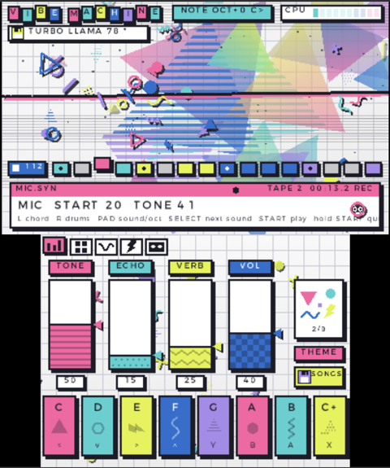
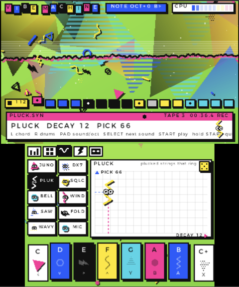
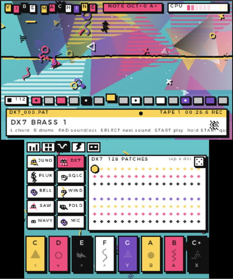
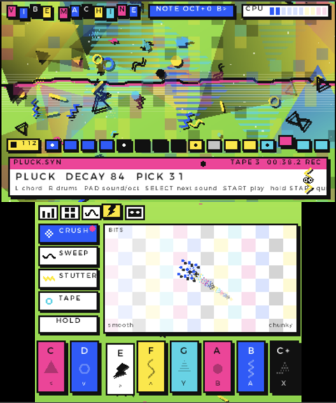
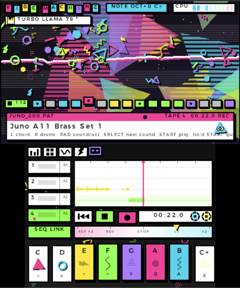
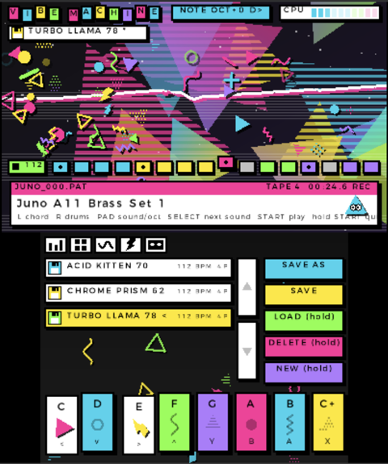

# Vibe Machine tutorial

A tour of everything Vibe Machine does, page by page, and then a few
recipes to get you making things. It takes about twenty minutes with the
3DS in your hands.

**Contents:**
[First sound](#1-your-first-sound) ·
[The screens](#2-finding-your-way-around) ·
[Playing](#3-playing-keys-chords-and-drums) ·
[SOUND](#4-the-sound-page) ·
[SEQ](#5-the-seq-page-making-beats) ·
[Parts](#6-parts-three-instruments-at-once) ·
[SYNTH](#7-the-synth-page-choosing-and-shaping-sounds) ·
[MIC](#8-sampling-your-voice-with-mic) ·
[FX](#9-the-fx-page-performance-effects) ·
[TAPE](#10-the-tape-page-recording-tracks) ·
[SONGS](#11-songs-saving-your-work) ·
[Looks](#12-themes-and-3d) ·
[Recipes](#13-recipes) ·
[Troubleshooting](#14-troubleshooting)

---

## 1. Your first sound

Start Vibe Machine and press **A**: you'll hear a note and see a burst of
triangles fly up the top screen. Now press **START**: the starter beat
(kick, snare, hats) plays. Press **START** again to stop it.

That's the whole loop: **keys make notes, START runs the beat**, and the
touchscreen shapes everything.

In the Azahar emulator, the 3DS buttons are on your keyboard (see
*Emulation → Configure → Controls*) and the mouse is the stylus.

## 2. Finding your way around

**Top screen** (look, don't touch):

- The title, and under it the **song name** sticker (`*` = unsaved changes).
- The **mode sticker**: NOTE / CHORD / DRUMS, the octave, and which pattern
  slot is playing (`A>` means song mode is chaining patterns).
- The **CPU meter**: how hard the 3DS is working on sound.
- The scene: a live waveform, layers of triangles that swell with the music,
  and a burst of shapes for every note.
- The **step strip**: 16 stickers; the playing step jumps up.
- The **patch card**: the current sound and its settings, the tape counter,
  and a reminder of the buttons.

**Bottom screen** (touch):

- Five **tabs** along the top: **SOUND** (sliders icon), **SEQ** (grid),
  **SYNTH** (wave), **FX** (bolt), **TAPE** (cassette).
- The page itself in the middle.
- The **eight keys** along the bottom, on every page, so you can always play.

## 3. Playing: keys, chords and drums

The eight keys are a C major scale. The D-pad plays the low four, the face
buttons the high four, each cluster read **left, down, right, up**:

| D-pad ← | D-pad ↓ | D-pad → | D-pad ↑ | Y | B | A | X |
|---|---|---|---|---|---|---|---|
| C | D | E | F | G | A | B | C (up an octave) |

You can also tap the keys on the touchscreen, and slide across them to
glide from note to note.

- **Hold L** for **chords**: each key plays the chord built on its note
  (C, Dm, Em, F, G, Am, Bdim, C). The key labels change to show them.
- **Hold R** for **drums**: KICK, SNARE, HAT, OPEN (hat), CLAP, RIM, TOM,
  CRASH.
- **Circle pad up / down** changes the octave (−3 to +3).

## 4. The SOUND page

- Four sliders, dragged up and down:
  - **TONE**: tilts the sound dark (down) or bright (up). 50 is neutral.
  - **ECHO**: how much echo.
  - **VERB**: how much reverb.
  - **VOL**: master volume.
- **THEME**: tap to cycle the nine colour themes (more in
  [section 12](#12-themes-and-3d)).
- **SONGS** (the floppy disk): the song browser
  ([section 11](#11-songs-saving-your-work)).

## 5. The SEQ page: making beats

The grid is one bar of 16 steps. From the top:

1. **The synth row**: the melody, labelled with the lowest note on each step.
   A small dot means a chord, and a bar shows a longer note holding. For
   full control of melodies, use the **piano roll** (below).
2. **The accent row**: a thin row of small triangles. Accented steps hit
   harder.
3. **Eight drum lanes**, in key order: kick, snare, hat, open hat, clap,
   rim, tom, crash. The coloured chips on the left show which lane is which.

### Programming a beat

- **Tap a cell** to switch it on or off.
- **Drag along a row** to paint: if you started on an empty cell you paint
  hits in, if you started on a full one you erase.
- **Synth row cells** use **the last note or chord you played**. Play a key
  (or hold L and play a chord), then tap synth cells to place it.

### The top row

| Sticker | Does |
|---|---|
| ▶ / ■ | Play / stop (same as START) |
| ● | Arm live recording (blinks when armed) |
| − 112 + | Tempo, 40–240 BPM. Hold − or + to scroll |
| ✕ | Clear the current pattern |
| Dice | Roll a fresh groove into the current pattern |

### Recording live

Arm **●**, press **START**, and play: notes land on the nearest step. Hold
**R** while recording to record drums, **L** for chords. Hits you play just
before a step are snapped onto it and not played twice.

### Patterns and songs

Along the bottom:

- **A–H**: eight pattern slots. **Tap** one to switch to it. While playing,
  the switch waits for the end of the bar (the slot blinks while it's
  queued). **Hold** a slot to **copy** the current pattern into it, the
  quick way to make a variation.
- **SONG**: when on, the sequencer plays every filled slot in order (A, B,
  C, …), one bar each, skipping empty ones, and loops.
- **ROLL**: switches the grid to the piano roll (below).
- **SW**: swing. Drag from 0% to 50%. It lengthens the on-beat 16ths and
  shortens the off-beat ones, for a shuffle.

### The piano roll

Tap **ROLL** (bottom row) to swap the grid for a **piano roll** of the same
pattern: pitches up the side, steps across. Drums stay on the grid; this is
where melodies, chords and long notes live.

- **Tap an empty spot** to add a note. You hear it as it lands. **Keep
  dragging right** as you place it to make it longer.
- **Drag a note** to move it in time or pitch.
- **Drag a note's last cell** to change its length. Notes can run past the
  end of the bar (a small arrow shows it) and hold over into the next.
- **Tap a note** (without dragging) to remove it.
- **Drag the keyboard strip** on the left to scroll up and down. Tap it to
  hear a pitch.
- **C / #** (top-left) switches between **C major** rows (every row is in
  key) and **chromatic** rows (every semitone). Notes outside the scale show
  a `#` in scale view.
- New notes take the length of the last note you stretched.
- **Notes you play light up.** Hold a key (or tap the keyboard strip) and
  its row glows in the part's colour, with the key on the strip filled in.
  If the note is off-screen, the roll scrolls to it, so changing octave
  brings you to the right place.

Notes you record live keep the length you held them for, and the grid's
synth row shows them too (a bar runs through the steps a long note holds).

### The dice

The dice don't roll pure noise. Kicks favour the downbeats, snares land on 2
and 4, hats fill in, accents fall on the beat, and the synth line plays a
short motif in a pentatonic scale. Roll until something grabs you, then
edit it.

## 6. Parts: three instruments at once

Vibe Machine has **three instrument parts** plus the drums. Each part has
its **own sound** (with its own patch and macros) and its **own notes** in
every pattern, so you can have, say, a SQUELCH bass on part 1, JUNO chords
on part 2 and a BELL lead on part 3, all playing together. They start as
**JUNO**, **PLUCK** and **BELL**.

- **Picking a part:** on SYNTH, tap one of the three part stickers along
  the top ("1 JUNO", "2 PLUK", "3 BELL"). On SEQ, tap the numbered chip at
  the left of the synth row (it cycles), or the 1 / 2 / 3 pickers in the
  piano roll's header.
- **Whatever part is picked** is the one the keys play, the SYNTH page
  shapes, the grid's synth row and the piano roll edit, and live recording
  records into. The top screen's patch card says which part you're on.
- In the piano roll, the **other parts' notes show faintly**, so you can
  write a bass line under your chords.
- **Muting:** hold a part sticker on the SYNTH page for about ⅔ of a second
  and it's struck through and silent. Hold again to unmute.
- **The SEQ dice** rolls new drums and new notes for the current part only;
  the other parts keep theirs.

## 7. The SYNTH page: choosing and shaping sounds

On the left, ten **sound tiles**, each with its own mascot. Tap one to switch
sound. **SELECT** cycles through them too.

### The creature pad

For Vibe Machine's own sounds, the right side is the **creature pad**. Drag
the mascot around: **left–right is the first macro, up–down the second**.
The crosshairs show where it is, and its eyes follow your stylus. The
**dice** in the corner throws it somewhere random.

| Sound | What it is | X (left → right) | Y (down → up) |
|---|---|---|---|
| **PLUCK** | Plucked strings that ring | DECAY: short → long ring | PICK: where it's plucked, warm → twangy |
| **SQUELCH** | Acid pulse bass with a resonant filter | CUTOFF: dark → bright | RESO: smooth → squelchy |
| **BELL** | FM chimes | RATIO: changes the bell's character, in steps | SHINE: pure → shimmery and metallic |
| **BREEZE** | Pitched, whistling wind (filtered noise) | WHISTLE: breathy → whistly | SHIFT: low → high whistle |
| **SUPERSAW** | Five detuned saws, huge chords | SPREAD: tight → wide and lush | CUTOFF: muffled → bright |
| **FOLD** | Wavefolded, crunchy lead | FOLD: soft → snarling | CRUSH: clean → bitcrushed |
| **WAVY** | Slowly morphing wavetables | MORPH: where in the table | TABLE: which of five tables |
| **MIC** | Your microphone recording, on the keys | START: where in the take each note begins | TONE: dark → bright |

### The Juno and DX7 banks

**JUNO** (128 vintage poly patches) and **DX7** (128 glassy FM patches)
show their patches as a 16 × 8 grid of **dots**. **Tap a dot** to load it,
or **slide across** them to audition. The patch name appears on the top
screen. The **circle pad ← →** steps through patches, and the **dice** picks
a random one.

## 8. Sampling your voice with MIC

1. On **SYNTH**, tap the **MIC** tile.
2. **Hold REC** (top of the pad) and sing, beatbox or tap something into the
   3DS microphone, for up to 3 seconds. The top screen shows a REC card with
   a level meter.
3. Let go. The take is tidied up: silence at the start is trimmed and the
   level is evened out, so it plays the moment you press a key.
4. Play the keys: **C plays it at its original pitch**, the others up the
   scale. Hold **L** for chords made of your voice.
5. The take's **waveform** fills the pad. Drag the mascot **left–right to
   choose where in the take each note starts** (the marker line), and
   **up–down for tone**.

The take is saved with your song. Until you record one, MIC plays a
cartoon "boing".

## 9. The FX page: performance effects

Pick an effect on the left, then **touch the pad**: the effect is on while
your stylus is down, and X and Y shape it. The pad's background shows what
the axes do.

| Effect | X | Y | Top screen |
|---|---|---|---|
| **CRUSH** | Sample rate: smooth → chunky | Bits: clean → lo-fi | Pixelates |
| **SWEEP** | Left: low-pass (dark). Middle: off. Right: high-pass (thin) | Resonance | Darkens / flashes |
| **STUTTER** | Repeat length: 1/2 to 1/32 note, locked to the tempo | Gate: full → choppy | Freezes and glitches |
| **TAPE** | How fast the tape stops: quick → slow | Wobble | Slows down and dims |

- **HOLD**: when it's on, effects **stay on** after you lift the stylus,
  so you can stack them. Tap a held effect's sticker again to drop it, or
  turn HOLD off to drop them all.
- A dot on a sticker means that effect is running.

## 10. The TAPE page: recording tracks

A four-track tape, 60 seconds long, that loops. It records **everything you
play, effects included**, so a stutter or tape-stop performance goes onto
tape exactly as you played it.

### Recording a track

1. **Tap a track sticker** (1–4) to choose which track records. It turns
   coloured.
2. Tap **●** to arm recording.
3. Tap **▶**. With **SEQ LINK** on (the default), the sequencer starts at
   the same moment, so your take lines up with the beat.
4. Play. The other tracks play back while you record, so you can layer.
5. Tap **■** to stop. The tape is saved when it stops.

The window shows all four tracks scrolling past the playhead (red while
recording).

### Playing with the tape

- **⏮** rewinds to the start.
- **Drag the tape window** to **scratch**: the tape moves with your stylus,
  and stops under your finger when you hold still.
- **The speed strip**: from **REV ×2** through **REV** and **STOP** to
  **×1** and **×2**. It snaps at reverse, stop and normal speed. Reverse
  anything you've recorded!
- **M** on a track mutes it.
- **Hold a track sticker** for about a second to **wipe** it. A bar fills
  while you hold.
- **SEQ LINK** off: the tape and sequencer start and stop independently.

## 11. Songs: saving your work

Open it from **SONGS** (the floppy disk) on the SOUND page.

- **SAVE AS** asks for a name on the 3DS keyboard and suggests a random one
  (*NEON GECKO 7*, *TURBO LLAMA 78*, …). If another song already has that
  name, you're asked to **hold** to replace it.
- **SAVE** saves over the current song. Only what changed is rewritten.
- **LOAD** opens the selected song. If you have unsaved changes, you have to
  hold it, so you can't lose work by accident.
- **DELETE** and **NEW** (a blank song) always need a hold.

A song keeps **everything**: all eight patterns, song mode, swing, tempo,
the sound and its macros, the sliders, the theme, the FX settings, **all
four tape tracks and your MIC take**.

The top screen shows the song's name, with `*` while there are unsaved
changes. Separately, whatever you're doing is autosaved as you go, so
you'll find it again next time you start, even without saving.

## 12. Themes and 3D

Tap **THEME** on the SOUND page to cycle through nine looks: **Prism**,
**Graph Paper**, **Midnight**, **Teal Pop**, **Lime Rave**, **Grape Soda**,
**Leopard**, **Sunshine** and the **Vapor Sunset**, with its striped sun
and neon grid.

Push up the **3D slider**: the back layers of triangles sink into the
screen, the waveform floats in the middle, and the bursts from your notes
fly out at you.

## 13. Recipes

**Bass, chords and lead**
1. SYNTH → part **1** → SQUELCH. SEQ → ROLL: draw a bass line in the low
   rows.
2. Part **2** → JUNO: draw long chords (stretch them across 4 steps). The
   bass shows faintly underneath.
3. Part **3** → BELL: a few high notes on top. Mute parts by holding their
   stickers to hear each layer alone.

**A beat in two minutes**
1. SEQ → tap the dice until you like the drums.
2. Play a key you like, then tap a few synth-row cells.
3. Drag SWING to about 20%. Press START.

**Build a song**
1. Make pattern **A**. Hold **B** to copy A into it, then change B a little:
   drop the kick, add a crash.
2. Hold **C**, roll the dice for a fill, and keep what you like.
3. Turn **SONG** on: A → B → C → A …

**Tape a performance**
1. TAPE → track 1 → ● → ▶ (the beat starts with it).
2. Switch to FX and play STUTTER and SWEEP over the beat. It all goes onto
   tape.
3. ■, then pick track 2 and record a melody over it.
4. Drag the speed strip to **REV** and listen to it backwards.

**Your voice as an instrument**
1. SYNTH → MIC → hold REC and sing "ooh" for a second.
2. Hold L and play chords, a choir of you.
3. Drag the mascot right to start each note mid-word for a stuttery feel.

**Wobble on demand**
1. FX → TAPE, HOLD on, touch the pad near the right ("slow stop") and high
   (wobble): the whole mix drops like a dying cassette.
2. Tap TAPE again to let it spin back up.

## 14. Troubleshooting

- **"NO AUDIO: DSP firmware missing"**: the 3DS needs `dspfirm.cdc` in
  `sdmc:/3ds/`. Run the DSP1 homebrew once. In Azahar, run
  `sh tools/azahar-sd-setup.sh` instead.
- **MIC says N/A**: the microphone service didn't start. Restart the app.
- **The CPU meter is high or there are gaps**: SUPERSAW chords, long FX
  chains and four busy tape tracks add up on an original 3DS. Use fewer
  voices, or bounce parts to tape.
- **Where are my files?** In `sdmc:/3ds/vibe-machine/`. Songs are folders
  in `songs/`, and the WAVs open in any audio editor.
