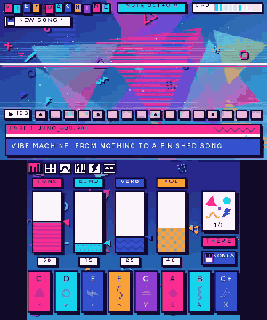
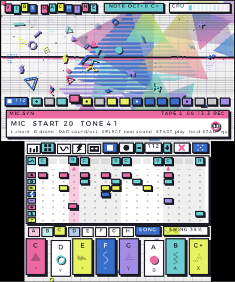
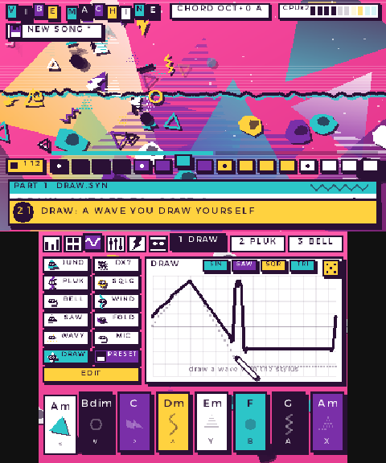
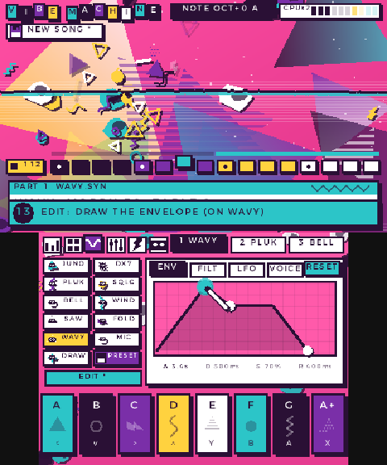
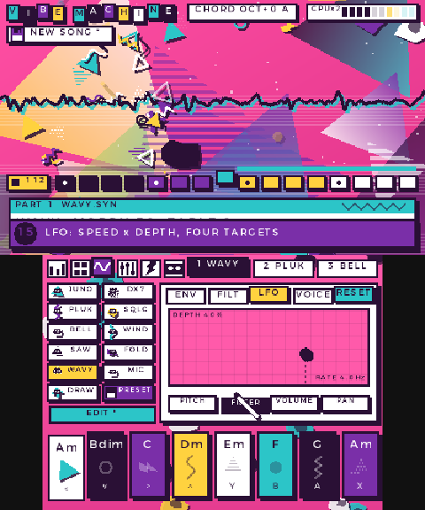
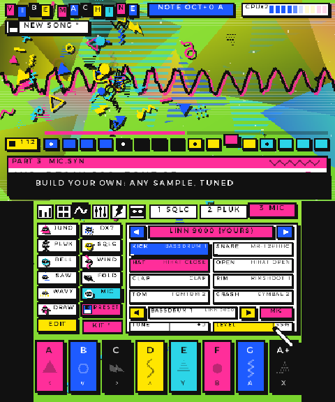
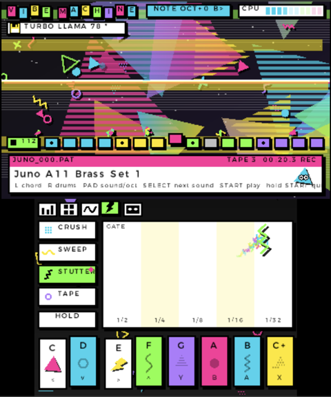

# Vibe Machine tutorial

A tour of everything Vibe Machine does, page by page, and then a few
recipes to get you making things. It takes about twenty minutes with the
3DS in your hands.

**From nothing to a finished song in ten steps:** jump to
[the walkthrough](#from-nothing-to-a-finished-song), or watch it happen in
the [demo video](media/zero-to-song.mp4). The
[feature tour](media/feature-tour.mp4) shows every feature, one at a time.

**Contents:**
[First sound](#1-your-first-sound) ·
[The screens](#2-finding-your-way-around) ·
[Playing](#3-playing-keys-chords-and-drums) ·
[SOUND](#4-the-sound-page) ·
[SEQ](#5-the-seq-page-making-beats) ·
[Parts](#6-parts-three-instruments-at-once) ·
[SYNTH](#7-the-synth-page-choosing-and-shaping-sounds) ·
[Sampler](#8-the-sampler-mic) ·
[MIX](#9-the-mix-page-balancing-the-parts) ·
[FX](#10-the-fx-page-performance-effects) ·
[TAPE](#11-the-tape-page-recording-tracks) ·
[SONGS](#12-songs-saving-your-work) ·
[Looks](#13-themes-and-3d) ·
[Recipes](#14-recipes) ·
[Troubleshooting](#15-troubleshooting)

---

## From nothing to a finished song

*(Click for the full video with sound. It's the app playing itself: `make
STORY=1` runs exactly these steps through the real touchscreen code.)*

The whole journey, in the order you'd do it. Each step links to the part of
this tutorial that explains it in depth.

1. **Drums.** SOUND → SONGS → **NEW** (hold) for an empty song, and set
   the **KEY** on the SOUND page (say A MINOR). Then go to **SEQ**. Tap kicks on the first drum lane, under the thin accent row
   (steps 1, 5, 9, 11, 13), snares on the next one down (5 and 13), and
   **drag along the third (hats)** to fill all 16.
   Press **START**. ([The SEQ page](#5-the-seq-page-making-beats))
2. **Bass.** **SYNTH** → part **1** → the **SQUELCH** tile. Back on SEQ,
   tap **ROLL** and draw a bass line in the low rows: tap to place a note,
   keep dragging right to make it longer. ([Piano roll](#the-piano-roll))
3. **Chords.** In the roll's header tap part **2**; on SYNTH pick **JUNO**.
   Draw three notes stacked on the same step and stretch them across 4–8
   steps: that's a chord. ([Parts](#6-parts-three-instruments-at-once))
4. **Lead.** Part **3** (BELL by default): a few high notes on top, or turn
   on **ARP** (SOUND page), record (●) and hold a chord with **L** for a bar:
   the arpeggiator writes the lead for you.
5. **Mix.** **MIX** page: drag the drums' **CRSH** knob up a little, the
   bass's **DRV** up, the chords' **PAN** a bit to one side and their fader
   down a touch. ([MIX](#9-the-mix-page-balancing-the-parts))
6. **A variation.** On SEQ, **hold B** to copy pattern A into it (B is now
   playing), then change it: an extra kick, a snare fill at the end.
7. **Movement.** Turn on **●** (record) on SEQ, go to **FX**, pick
   **SWEEP** and drag across the pad for a bar: the filter sweep is now
   part of pattern B. Turn ● off. ([Recording FX moves](#recording-fx-moves-automation))
8. **Arrange.** **Hold SONG**. Tap **+**, pick **A**, tap it again for ×2
   and drop the drums with **D** (an intro); then A×2, B×4, A×2, B×2. Leave
   the end on **STOP**. ([The SONG sheet](#the-song-sheet-arranging))
9. **Save.** SOUND → SONGS → **SAVE AS**, and give it a name.
   ([Songs](#12-songs-saving-your-work))
10. **Mix it down.** MIX → **MIXDOWN**. The song plays from the top and is
    recorded, as you hear it, to `sdmc:/3ds/vibe-machine/mixes/<NAME>.wav`
   (stereo, at the 3DS's own 32.7 kHz).
    It stops by itself at the end. Copy the file off the SD card: done.
    ([MIXDOWN](#mixdown-your-song-as-a-wav))

**Going further:** record your voice or grab a bar from the tape into the
[sampler](#8-the-sampler-mic) and **CHOP** it into slices; layer
performances on the [tape](#11-the-tape-page-recording-tracks); play the FX
live during the mixdown. Hold ✕ on SEQ to **undo** your last pattern edits.

---

## 1. Your first sound

Start Vibe Machine and press **A**: you'll hear a note and see a burst of
triangles fly up the top screen. Now press **START**: the starter beat
(kick, snare, hats) plays. Press **START** again to stop it.

That's the whole loop: **keys make notes, START runs the beat**, and the
touchscreen shapes everything.

In the Azahar emulator, the 3DS buttons are on your keyboard (see
*Emulation → Configure → Controls*) and the mouse is the stylus.

## 2. Finding your way around

**Top screen** (look, don't touch):

- The title, and under it the **song name** sticker (`*` = unsaved changes).
- The **mode sticker**: NOTE / CHORD / DRUMS, the octave, and which pattern
  slot is playing (`A>` means song mode is chaining patterns).
- **Recording badges** under the CPU meter, on every page: **REC** (red,
  blinking) while the sequencer is recording, **REC ARMED** when ● is on
  but nothing's playing yet; **TAPE 1 REC / ARMED** for the tape; and
  **MIXDOWN** during a mixdown.
- The **CPU meter**: how hard the 3DS is working on sound. **CPUx2** means
  both of the 3DS's processor cores are sharing the work (the usual case).
  If it reaches the red end, the sound can break up (**gaps** counts how
  often): fewer notes ringing at once, or a lighter sound than JUNO or DX7,
  brings it down.
- The scene: a live waveform, layers of triangles that swell with the music,
  and a burst of shapes for every note.
- The **step strip**: 16 stickers, one bar; the playing step jumps up.
  With a 2- or 4-bar pattern it shows the bar that's playing (or, when
  stopped, the bar on the bottom screen), and a thin row of segments above
  it, one per bar, lights the one it's on.
- The **patch card**: the current sound and its settings, the tape counter,
  and a reminder of the buttons.

**Bottom screen** (touch):

- Six **tabs** along the top: **SOUND** (sliders icon), **SEQ** (grid),
  **SYNTH** (wave), **MIX** (faders), **FX** (bolt), **TAPE** (cassette).
- The page itself in the middle.
- The **eight keys** along the bottom, on every page, so you can always play.

## 3. Playing: keys, chords and drums

The eight keys are a C major scale. The D-pad plays the low four, the face
buttons the high four, each cluster read **left, down, right, up**:

| D-pad ← | D-pad ↓ | D-pad → | D-pad ↑ | Y | B | A | X |
|---|---|---|---|---|---|---|---|
| C | D | E | F | G | A | B | C (up an octave) |

You can also tap the keys on the touchscreen, and slide across them to
glide from note to note.

- **Hold L** for **chords**: each key plays the chord built on its note
  (C, Dm, Em, F, G, Am, Bdim, C). The key labels change to show them.
- **Hold R** for **drums**: KICK, SNARE, HAT, OPEN (hat), CLAP, RIM, TOM,
  CRASH.
- **Circle pad up / down** changes the octave (−3 to +3).
- **Pitch bend:** hold **SELECT** and push the **circle pad** left or right
  to bend everything that's playing down or up (two semitones at full
  tilt). Let go and it springs back. (A quick tap of SELECT, without
  bending, still picks the next sound; holding it never does. The drums
  don't bend.)

## 4. The SOUND page

- Four sliders, dragged up and down:
  - **TONE**: tilts the sound dark (down) or bright (up). 50 is neutral.
  - **ECHO**: how much echo (each MIX strip's ECHO knob decides how much of
    that part goes into it, e.g. none of the drums).
  - **VERB**: how much reverb (likewise per strip).
  - **VOL**: master volume.
  These four work on the whole mix. To change one part, use its strip on
  the [MIX page](#9-the-mix-page-balancing-the-parts).
- **KEY** (under the sliders): the song's **key**. Tap the left or right
  half of the note to go down or up a semitone, and of the scale to step
  through **MAJOR, MINOR, DORIAN, MIXOLYDIAN, HARMONIC MIN, MAJOR PENTA,
  MINOR PENTA, BLUES**. The 8 keys then play that scale from its root
  (shorter scales carry on into the next octave), chords are built from it
  (the keys show their names: Am, Bdim, F…), the piano roll's scale view
  shows only its notes, and the dice stay in it. Notes you've already
  written stay as they are, except a chopped MIC part's: those pick
  slices, so they move to the same steps of the new scale and a break you
  programmed keeps playing the same slices.
- **ARP**: the **arpeggiator**. Tap **ARP** to turn it on; then whatever you
  hold on the keys (a note, or a chord with **L**) is played one note at a
  time. The stickers after it set the order (**UP, DOWN, UP-DN, RAND**),
  the speed (**1/8, 1/16, 1/32**, locked to the tempo) and the range (**1**
  or **2 OCT**). With the sequencer recording (●), the notes it plays go
  into the pattern, so you can hold a chord for a bar and get an arpeggio
  written for you. At 1/32 the notes between the steps go in too, as
  half-width notes starting halfway through their step on the piano roll.
  The top screen's mode sticker says **ARP** while it's on.
- **THEME**: tap to cycle the nine colour themes (more in
  [section 13](#13-themes-and-3d)).
- **SONGS** (the floppy disk): the song browser
  ([section 12](#12-songs-saving-your-work)).

## 5. The SEQ page: making beats

The grid is one bar of 16 steps. From the top:

1. **The synth row**: the melody, labelled with the lowest note on each step.
   A small dot means a chord, and a bar shows a longer note holding. For
   full control of melodies, use the **piano roll** (below).
2. **The accent row**: a thin row of small triangles. Accented steps hit
   harder.
3. **Eight drum lanes**, in key order: kick, snare, hat, open hat, clap,
   rim, tom, crash. The coloured chips on the left show which lane is which.

### Programming a beat

- **Tap a cell** to switch it on or off.
- **Drag along a row** to paint: if you started on an empty cell you paint
  hits in, if you started on a full one you erase.
- **Synth row cells** use **the last note or chord you played**. Play a key
  (or hold L and play a chord), then tap synth cells to place it.

### The top row

| Sticker | Does |
|---|---|
| ▶ / ■ | Play / stop (same as START) |
| ● | Arm live recording (blinks when armed) |
| − 112 + | Tempo, 40–240 BPM. Hold − or + to scroll |
| ✕ | **Tap**: clear the current pattern (in the piano roll, only the current part's notes). **Hold**: **undo** the last pattern edit: a painted stroke, a piano-roll note, a live take, a bar-length change, a clear, a dice roll or a slot copy. Hold again to go further back (up to 8 edits); hold with **L** to redo |
| Dice | Roll a fresh groove into the current pattern |

### Recording live

Arm **●**, press **START**, and play: notes land on the nearest step, as
you heard it (the sound still on its way to the speaker is allowed for, so
on-time playing stays on time at fast tempos too). Hold
**R** while recording to record drums, **L** for chords. Hits you play just
before a step are snapped onto it and not played twice.

The keys along the bottom flash with the beat to show what they'd play.
On the grid they flash for the drums too (each drum lane is a key); in the
piano roll, and on the other pages, they flash only for the **current
part's** notes, so the drums don't get in the way of playing a melody.
Hold **R** and they show the drums again.

### Patterns and songs

Along the bottom:

- **A–H**: eight pattern slots. **Tap** one to switch to it. While playing,
  the switch waits for the end of the bar (the slot blinks while it's
  queued). **Hold** a slot to **copy** the current pattern into it, the
  quick way to make a variation.
- **SONG**: **tap** to turn song mode on. With no arrangement, it plays
  every filled slot in order (A, B, C, …), one bar each, and loops.
  **Hold** it to open the **SONG sheet** (below) and arrange a real song.
- **ROLL**: switches the grid to the piano roll (below).
- **BAR** (`1/2`): patterns can be **1, 2 or 4 bars** long. **Hold** BAR to
  change the current pattern's length: 1 → 2 → 4 → 1. Growing a pattern
  copies what's there into the new bars, ready for you to vary; shrinking
  only hides the extra bars (grow it again and they're back). The grid and
  the roll show **one bar at a time**: **tap** BAR for the next one. The
  dots under it show which bar is playing. While you **record live**, the
  screen follows the playhead from bar to bar, so you can play a long
  melody straight in.
- **SW**: swing. Drag from 0% to 50%. It lengthens the on-beat 16ths and
  shortens the off-beat ones, for a shuffle.

### The SONG sheet: arranging

**Hold SONG** (about half a second) and the grid becomes the **SONG
sheet**: your song as a row of stickers, played left to right, top to
bottom. Each sticker is a pattern slot and how many bars it plays.

- **Tap +** to add a sticker. It starts as the slot you're on, for 1 bar.
- **Tap a sticker** to pick it (it gets an outline). **Tap it again** to
  repeat it: ×1 → ×2 → ×4 → ×8 bars.
- With a sticker picked, **tap a slot A–H** along the bottom to make it
  play that pattern.
- The chips **1 2 3 D** in the header drop a part (or the drums) out of the
  picked sticker: for an intro without drums, or a breakdown with just the
  bass. Dropped parts show as dots on the sticker.
- **DEL** removes the picked sticker.
- **STOP / LOOP** (top left): what happens at the end. **STOP** ends the
  song there, which is what you want for a finished song (and a mixdown).
- The header shows the song's length in bars and minutes.

Press **START** and the song plays from the first sticker; the playing one
fills up as it goes, and the top screen shows **ROW 3/8**. Tap **ROLL** or
hold **SONG** again to go back to editing patterns. Up to 32 stickers × 8
bars: 256 bars.

A typical pop shape with three patterns (A verse, B chorus, C a variation):
`A×4 (drums dropped)`, `A×4`, `B×4`, `A×4`, `B×4`, `C×2`, `B×4`, with STOP.

### The piano roll

Tap **ROLL** (bottom row) to swap the grid for a **piano roll** of the same
pattern: pitches up the side, steps across. Drums stay on the grid; this is
where melodies, chords and long notes live.

- **Tap an empty spot** to add a note. You hear it as it lands. **Keep
  dragging right** as you place it to make it longer.
- **Drag a note** to move it in time or pitch.
- **Drag a note's last cell** to change its length. Notes can run past the
  end of the bar (a small arrow shows it) and hold over into the next.
- **Tap a note** (without dragging) to remove it.
- **Hold L and tap a note** to change how hard it plays: normal → **loud**
  (a bar along its top) → **soft** (washed out) → normal. Accents still
  push a step's notes up to loud.
- **Hold R and tap a note** to make it **slide** (a little ramp off its
  end): it holds on into the next note. On a sound set to **MONO** with some
  **GLIDE** (SYNTH → EDIT → VOICE), the pitch slides from one note to the
  next: the acid bass trick. Tap again to turn it off.
- **Drag the keyboard strip** on the left to scroll up and down. Tap it to
  hear a pitch.
- **C / #** (top-left) switches between **C major** rows (every row is in
  key) and **chromatic** rows (every semitone). Notes outside the scale show
  a `#` in scale view.
- New notes take the length of the last note you stretched.
- **Notes you play light up.** Hold a key (or tap the keyboard strip) and
  its row glows in the part's colour, with the key on the strip filled in.
  If the note is off-screen, the roll scrolls to it, so changing octave
  brings you to the right place.

Notes you record live keep the length you held them for, and the grid's
synth row shows them too (a bar runs through the steps a long note holds).

### The dice

The dice don't roll pure noise. Kicks favour the downbeats, snares land on 2
and 4, hats fill in, accents fall on the beat, and the synth line plays a
short motif in a pentatonic scale. Roll until something grabs you, then
edit it.

## 6. Parts: three instruments at once

Vibe Machine has **three instrument parts** plus the drums. Each part has
its **own sound** (with its own patch and macros) and its **own notes** in
every pattern, so you can have, say, a SQUELCH bass on part 1, JUNO chords
on part 2 and a BELL lead on part 3, all playing together. They start as
**JUNO**, **PLUCK** and **BELL**.

- **Picking a part:** on SYNTH, tap one of the three part stickers along
  the top ("1 JUNO", "2 PLUK", "3 BELL"). On SEQ, tap the numbered chip at
  the left of the synth row (it cycles), or the 1 / 2 / 3 pickers in the
  piano roll's header.
- **Whatever part is picked** is the one the keys play, the SYNTH page
  shapes, the grid's synth row and the piano roll edit, and live recording
  records into. The top screen's patch card says which part you're on.
- In the piano roll, the **other parts' notes show faintly**, so you can
  write a bass line under your chords.
- **Muting:** hold a part sticker on the SYNTH page for about ⅔ of a second
  and it's struck through and silent. Hold again to unmute. (Or use
  **MUTE** on the [MIX page](#9-the-mix-page-balancing-the-parts), which
  also has levels and effects for each part.)
- **The SEQ dice** rolls new drums and new notes for the current part only;
  the other parts keep theirs.

## 7. The SYNTH page: choosing and shaping sounds

On the left, eleven **sound tiles**, each with its own mascot. Tap one to
switch sound. **SELECT** cycles through them too. Under them, **PRESET**
opens your saved sounds, and **EDIT** (along the bottom) opens the sound's
insides: see [EDIT](#edit-shaping-any-sound) below.

### The creature pad

For Vibe Machine's own sounds, the right side is the **creature pad**. Drag
the mascot around: **left–right is the first macro, up–down the second**.
The crosshairs show where it is, and its eyes follow your stylus. The
**dice** in the corner throws it somewhere random.

| Sound | What it is | X (left → right) | Y (down → up) |
|---|---|---|---|
| **PLUCK** | Plucked strings that ring | DECAY: short → long ring | PICK: where it's plucked, warm → twangy |
| **SQUELCH** | Acid pulse bass with a resonant filter | CUTOFF: dark → bright | RESO: smooth → squelchy |
| **BELL** | FM chimes | RATIO: changes the bell's character, in steps | SHINE: pure → shimmery and metallic |
| **BREEZE** | Pitched, whistling wind (filtered noise) | WHISTLE: breathy → whistly | SHIFT: low → high whistle |
| **SUPERSAW** | Five detuned saws, huge chords | SPREAD: tight → wide and lush | CUTOFF: muffled → bright |
| **FOLD** | Wavefolded, crunchy lead | FOLD: soft → snarling | CRUSH: clean → bitcrushed |
| **WAVY** | Slowly morphing wavetables | MORPH: where in the table | TABLE: which of five tables |
| **MIC** | Your microphone recording, on the keys | DECAY: short chops → plays to the end | TONE: dark → bright |
| **DRAW** | A wave you draw yourself (see below) | — the pad is the drawing | |

### The Juno and DX7 banks

**JUNO** (128 vintage poly patches) and **DX7** (128 glassy FM patches)
show their patches as a 16 × 8 grid of **dots**. **Tap a dot** to load it,
or **slide across** them to audition. The patch name appears on the top
screen. The **circle pad ← →** steps through patches, and the **dice** picks
a random one.

### DRAW: a wave you draw yourself

Pick **DRAW** and the pad becomes a canvas. **Drag across it** to draw one
cycle of a wave, left to right; the thick line is what you hear (smoothed,
centred and levelled), and it changes while a note is still sounding. The
four stickers at the top start you from a **SIN**e, **SAW**, **SQR**are or
**TRI**angle. Each part keeps its own drawing, and it's saved with the song.
Smooth curves sound soft; sharp corners and steps sound buzzy and bright.

### EDIT: shaping any sound

 

Tap **EDIT** and the pad shows four tabs. Every control starts where the
sound itself is (nothing changes until you touch it), and **RESET** puts the
sound back as designed. EDIT is kept per part, saved with the song, and
stays when you step through a bank's patches, so you can try the same
shaping on another patch. A sound you haven't used on this part yet starts
as designed; one you have comes back as you left it (its patch, macros and
EDIT, for as long as the app is running), so stepping to another sound by
accident costs nothing.

- **ENV**: the volume envelope, drawn. Drag the three handles: the first is
  the **attack** (left: instant, right: a slow swell), the second sets the
  **decay** (across) and **sustain** level (up and down), the last the
  **release** after you let go.
- **FILT**: the **filter**. Across the pad is the **cutoff** (dark → bright),
  up it is the **resonance** (smooth → whistling). **ENV AMOUNT** underneath
  makes the cutoff follow the envelope: right of the middle opens up as the
  note starts, left closes. Sounds without a filter get one when you touch
  this.
- **LFO**: a wobble. Across is its **speed**, up its **depth**; the stickers
  underneath pick what it moves: **PITCH** (vibrato), **FILTER** (wah),
  **VOLUME** (tremolo) or **PAN** (left to right).
- **VOICE**:
  - **MONO / POLY**: MONO plays one note at a time, and with **GLIDE** each
    note slides to the next (great for basses and leads; see *slide* on the
    piano roll).
  - **x1 x2 x3**: **unison**, two or three copies of every note, spread
    apart by **DETUNE**: thicker and wider. To keep the 3DS from running out
    of breath, the sound gets fewer voices as you add copies (a 4-voice
    sound at x2 plays two notes at once). The FM, KS and sample sounds
    (DX7, BELL, PLUCK, BREEZE, MIC) can't do unison.
  - **BRIGHT**: on the **DX7**, how hard its FM modulators hit: dull and
    round at the left, glassy and cutting at the right. On the filtered
    sounds it moves the cutoff.
  - **MUTATE** nudges everything a little at random: tap it a few times to
    wander away from where you are.
  - **A** and **B** store the sound as it is now (EDIT and the creature
    pad's macros). Once both are stored, **MORPH** slides smoothly between
    them, which is fun with the sequencer playing.

On the **JUNO**, ENV also moves its filter's envelope (as on the real
thing), and the LFO is the patch's own.

### PRESETS: saving your sounds

Tap **PRESET** to open your saved sounds. **SAVE AS** keeps the part's sound
as it is now (the sound, patch, macros, EDIT and DRAW wave) under a name;
**LOAD** puts a saved one on the part you're playing; hold **DELETE** to
remove one; **BACK** returns to SYNTH. They're small files in
`3ds/vibe-machine/presets/`, so you can copy them between SD cards.

## 8. The sampler: MIC

The **MIC** sound plays a sample: your voice, a sound you tapped into the
microphone, a bar grabbed from the tape, or a WAV from the library. Tap the
**MIC** tile on **SYNTH** and the pad becomes a **sample editor**.

**Getting a sample in:**

- **REC**: hold it and sing, beatbox or tap something into the 3DS
  microphone, for up to 4 seconds. Let go and the take is tidied up
  (silence trimmed, level evened out).
- **From the tape**: on the TAPE page, put the playhead in a bar and tap
  **SAMPLE**. That bar of the picked track becomes the sample (bars count
  from the start of the tape, where SEQ LINK starts the beat).
- **LIB** (the floppy): the **sample library**. Pick one and tap **LOAD**.

**Editing it:**

- The take's waveform fills the editor. Drag the **S** (start) and **E**
  (end) handles to choose the part that plays; the rest dims.
- **CHOP** cuts that part into **4** or **8** slices (tap again for 8,
  again for off). The cuts go **on the hits**: just before the strongest
  attacks (drum hits, syllables), each on a zero crossing so it doesn't
  click. A sound with no clear hits is cut evenly. The notice says which
  ("CUT AT THE HITS" / "EVEN SLICES").
- **Drag any cut** by its little grip under the waveform to move it; it
  stops at its neighbours, and snaps to the nearest zero crossing when you
  let go. Dragging S or E over the cuts pushes them along.
- Chopped, **each key plays one slice** at its own pitch: the first key
  (C, in C major) plays slice 1, the next slice 2, and so on up the keys,
  in any key. A one-bar drum loop chopped into 8 gives you its hits to
  rearrange on the grid or the piano roll; changing the song's key later
  doesn't rearrange them.
- **▶KIT** (top left, when chopped) puts the slices onto the **drum lanes**:
  slice 1 on KICK, 2 on SNARE, and so on (see [KIT](#the-drum-kit)).
- Not chopped, the part plays **pitched across the keys**: C is the
  original pitch, the others go up the scale. Hold **L** for chords.
- **Tap the waveform** to hear that slice (or the whole part). Slices
  light up as they play.
- **DECAY**: how long each note lasts while held, from a tight chop to the
  whole slice. **TONE**: dark to bright.

**The library** (LIB): **SAVE AS** saves the part between the handles
under a name; **LOAD** puts a saved sample into MIC; **DELETE** (hold)
removes one; **BACK** returns to the editor. Samples are ordinary WAV files
in `sdmc:/3ds/vibe-machine/samples/`, so you can copy your own in from a
computer: any 16-bit WAV, mono or stereo, any sample rate (the first 4
seconds are used).

The current sample, its handles and CHOP are saved with your song. Until you
record or load one, MIC plays a cartoon "boing".

### The drum kit

Tap **KIT** (bottom right of the sound tiles) and the pad shows the drums.

- **◀ name ▶** at the top steps through the **seven kits**: TR-808, TR-909,
  Linn 9000, MR-12, Tokyo Synthetics, Power and Percussion. The beat
  carries on in the new kit straight away.
- The **eight lanes** (KICK … CRASH) show what each plays. **Tap a lane**
  to pick it and hear it; lanes light up as they're hit.
- **Build your own kit** from the picked lane's row underneath:
  - **◀ sample ▶** steps through all **155 drum samples**, from every kit
    (hold to run through them). Any lane can play anything: a 909 kick
    with Linn hats and a conga for a tom.
  - **MIC** puts the MIC sound's sample (the part between its S and E
    handles) on the lane: record a clap, a knock or a beatbox snare, or
    load a WAV into MIC from the library first.
  - **TUNE** (±24 semitones) and **LEVEL** (0–200%).
  - A changed kit says **(YOURS)**; a dot marks the lanes you changed.
    Stepping to another kit starts again from that kit.
- The closed **HAT** cuts off a ringing **OPEN** hat, as on a real drum
  machine.

The kit is saved with your song, including lanes playing your own samples
(as `drum1.wav`…`drum8.wav` in the song's folder).

## 9. The MIX page: balancing the parts

The MIX page (the faders icon) has a **channel strip** for each part and
one for the drums. Every part plays through its own strip, so you can turn
the bass down, crush the drums or push the lead to one side without
touching anything else.

A strip, top to bottom:

- **Name sticker**: the part and its sound ("2 PLUCK"), or DRUMS. Tap a
  part's sticker and the keys play that part. A small triangle marks the
  part you're on.
- **Fader** (left): the strip's level. The little ticks are where it
  starts; the top is about 5 dB louder. Drag the cap up or down. The
  **meter** inside the fader lights up as the part plays, and the top two
  segments run hot.
- **Six knobs**, in three rows: DRV CRSH / ECHO VERB / TONE PAN. Drag up to
  turn one up, down to turn it down. Its value shows underneath while you
  turn it.

  | Knob | Does |
  |---|---|
  | **DRV** (drive) | Soft clipping: warm, then fuzzy. It's levelled, so it gets dirtier rather than much louder. |
  | **CRSH** (crush) | Fewer bits and a lower sample rate: gritty, then a broken toy. |
  | **ECHO** | How much of this strip goes into the echo (a *send*): turn it down for drums, up for a lead. |
  | **VERB** | How much goes into the reverb. |
  | **TONE** | Dark ← middle → bright, like the SOUND page's TONE but for this strip only. |
  | **PAN** | Left ← centre → right. Clearest on headphones. |

  TONE and PAN click into the middle as you pass it.
- **Double-tap** a knob or fader to put it back where it started.
- **MUTE** silences the strip. **SOLO** silences every strip that isn't
  soloed (solo several to hear just those). Silenced strips fade back.

Good to know:

- MUTE here and holding a part sticker on the SYNTH page are the same
  switch: either one turns it on or off. The drums can only be muted here.
- There's **one echo and one reverb** for the whole song: each strip's ECHO
  and VERB knobs choose how much of that strip goes into them, and the
  SOUND page's ECHO and VERB sliders set how loud they come back. A new
  song starts with the drums out of the echo and only a little in the
  reverb; everything else fully in. TONE and VOL on the SOUND page work on
  the whole mix, and the FX page's effects come after that, on everything.
- The mixer is saved with the song.

### MIXDOWN: your song as a WAV

**MIXDOWN** (top right of the MIX page) records the finished song to a
stereo WAV file, at full quality:

1. Tap **MIXDOWN**. The song starts from the top (with the tape, if SEQ
   LINK is on) and everything you hear is recorded: the parts, the mixer,
   the tape, and anything you play or do on the FX page while it runs. The
   sticker and the top screen show **MIXDOWN 0:12** as it goes.
2. With a **STOP** arrangement (the [SONG sheet](#the-song-sheet-arranging)),
   it ends by itself when the song does, plus three seconds so the echo
   and reverb ring out (**TAIL**). Otherwise press **START** or tap the
   sticker to stop; tap again during TAIL to finish at once.
3. The file is `sdmc:/3ds/vibe-machine/mixes/<SONG NAME>.wav` (or
   `UNTITLED.wav`), replaced each time you mix that song. Copy it off the SD
   card and share it.

## 10. The FX page: performance effects

Pick an effect on the left, then **touch the pad**: the effect is on while
your stylus is down, and X and Y shape it. The pad's background shows what
the axes do.

| Effect | X | Y | Top screen |
|---|---|---|---|
| **CRUSH** | Sample rate: smooth → chunky | Bits: clean → lo-fi | Pixelates |
| **SWEEP** | Left: low-pass (dark). Middle: off. Right: high-pass (thin) | Resonance | Darkens / flashes |
| **STUTTER** | Repeat length: 1/2 to 1/32 note, locked to the tempo | Gate: full → choppy | Freezes and glitches |
| **TAPE** | How fast the tape stops: quick → slow | Wobble | Slows down and dims |

- **HOLD**: when it's on, effects **stay on** after you lift the stylus,
  so you can stack them. Tap a held effect's sticker again to drop it, or
  turn HOLD off to drop them all.
- A dot on a sticker means that effect is running.

### Recording FX moves (automation)

Your bitcrusher sweep can be part of the pattern:

1. On SEQ, turn on **●** (record) and press **START**.
2. Go to **FX** and play the pad: **REC MOVES** shows in its corner, and
   every step you hold the pad over remembers the effect and where your
   stylus was. A strip of 16 cells along the bottom of the pad shows which
   steps have a move, in the effect's colour.
3. Turn ● off. From now on that pattern plays your moves back by itself:
   the effect comes on at those steps and goes off at the first step
   without one. Touch the pad at any time to take over.
4. **Tap a cell** in the strip to erase that step's move. ✕ on the grid
   clears the moves along with everything else in the pattern.

Moves belong to the pattern (slot), so a chorus slot can have its own
filter sweep, and they're saved with the song.

## 11. The TAPE page: recording tracks

A four-track tape, 60 seconds long, that loops. Think of it as a
multitrack recorder for **performances**: you play a pass, it goes on
tape, and the tape plays it back while you play the next one. (For
recording a sound to play on the keys, use the **MIC** sound:
[section 8](#8-the-sampler-mic).)

Each track has a **source**, the chip next to its number. Pick the track,
then tap its chip to change the source:

- **ALL**: everything you hear: what you're playing live, the other tape
  tracks, and the FX page on top, so a stutter or tape-stop performance goes
  onto tape exactly as you heard it. Recording ALL while other tracks play
  **bounces** them together onto this one (mute the ones you bounced
  afterwards, or you'll hear them twice).
- **DRUMS**, **PART 1**, **PART 2**, **PART 3**: just that strip of the
  [MIX page](#9-the-mix-page-balancing-the-parts), with its level and strip
  effects, but without the master echo, reverb or the FX page. Tape tracks
  are mono, so pan isn't kept.

### Recording a track

1. **Tap a track sticker** (1–4) to choose which track records. It turns
   coloured. Tap its chip again to change the source.
2. Tap **●** to arm recording.
3. Tap **▶**. With **SEQ LINK** on (the default), the sequencer starts at
   the same moment, so your take lines up with the beat.
4. Play. The other tracks play back while you record, so you can layer.
5. Tap **■** to stop. The tape is saved when it stops (in the background:
   you can carry on playing while it writes). A take that reaches
   the end of the tape (60 seconds) stops there by itself.

If the source was one strip, that strip is **muted live** when the take
ends, so you hear it once, from the tape, instead of twice. A notice says
so, and the strip's sticker on MIX gets a little cassette. Unmute it on MIX
to hear both, or to record it again. (A take of a strip that's muted would
be silent, so you get a warning when one starts.)

The window shows all four tracks scrolling past the playhead (red while
recording).

### Building a song layer by layer

1. Track **1**, source **DRUMS**: ● ▶, let the beat play a few bars, ■.
   The live drums mute; the tape has them now.
2. Track **2**, source **PART 1**: record a bass line over the taped drums.
3. Track **3**, source **PART 2**: chords. Now every layer is on tape, and
   you're free to change the patterns, sounds or effects without losing
   what you recorded, or to scratch, reverse and slow the tape.
4. Use **ALL** for a final pass with the FX page: a stutter or a tape stop
   over the whole thing (live and taped) onto track 4. Then mute tracks 1–3
   and track 4 is your performance.

### Playing with the tape

- **⏮** rewinds to the start.
- **Drag the tape window** to **scratch**: the tape moves with your stylus,
  and stops under your finger when you hold still.
- **The speed strip**: from **REV ×2** through **REV** and **STOP** to
  **×1** and **×2**. It snaps at reverse, stop and normal speed. Reverse
  anything you've recorded!
- **M** on a track mutes it.
- **Hold a track sticker** for about a second to **wipe** it. A bar fills
  while you hold.
- **SEQ LINK** on: **START** plays the tape from the top along with the
  beat (and stops it), so your taped layers always play along. Off: the
  tape and sequencer start and stop independently.

## 12. Songs: saving your work

Open it from **SONGS** (the floppy disk) on the SOUND page.

- **SAVE AS** asks for a name on the 3DS keyboard and suggests a random one
  (*NEON GECKO 7*, *TURBO LLAMA 78*, …). If another song already has that
  name, you're asked to **hold** to replace it.
- **SAVE** saves over the current song. Only what changed is rewritten.
- **LOAD** opens the selected song. If you have unsaved changes, you have to
  hold it, so you can't lose work by accident.
- **DELETE** and **NEW** (a blank song) always need a hold.

A song keeps **everything**: all eight patterns, song mode, swing, tempo,
each part's sound and macros, the mixer, the sliders, the theme, the FX
settings, **all four tape tracks and your MIC take**.

The top screen shows the song's name, with `*` while there are unsaved
changes. Separately, whatever you're doing is autosaved as you go, so
you'll find it again next time you start, even without saving.

## 13. Themes and 3D

Tap **THEME** on the SOUND page to cycle through nine looks: **Prism**,
**Graph Paper**, **Midnight**, **Teal Pop**, **Lime Rave**, **Grape Soda**,
**Leopard**, **Sunshine** and the **Vapor Sunset**, with its striped sun
and neon grid.

Push up the **3D slider**: the back layers of triangles sink into the
screen, the waveform floats in the middle, and the bursts from your notes
fly out at you.

## 14. Recipes

**Bass, chords and lead**
1. SYNTH → part **1** → SQUELCH. SEQ → ROLL: draw a bass line in the low
   rows.
2. Part **2** → JUNO: draw long chords (stretch them across 4 steps). The
   bass shows faintly underneath.
3. Part **3** → BELL: a few high notes on top. Mute parts by holding their
   stickers to hear each layer alone.

**A beat in two minutes**
1. SEQ → tap the dice until you like the drums.
2. Play a key you like, then tap a few synth-row cells.
3. Drag SWING to about 20%. Press START.

**Build a song**
1. Make pattern **A**. Hold **B** to copy A into it, then change B a little:
   drop the kick, add a crash.
2. Hold **C**, roll the dice for a fill, and keep what you like.
3. Turn **SONG** on: A → B → C → A …

**Tape a performance**
1. TAPE → track 1 → ● → ▶ (the beat starts with it).
2. Switch to FX and play STUTTER and SWEEP over the beat. It all goes onto
   tape.
3. ■, then pick track 2 and record a melody over it.
4. Drag the speed strip to **REV** and listen to it backwards.

**Your voice as an instrument**
1. SYNTH → MIC → hold REC and sing "ooh" for a second.
2. Hold L and play chords, a choir of you.
3. Drag the mascot right to start each note mid-word for a stuttery feel.

**Make room in the mix**
1. MIX → pull the bass strip's fader down a little until the chords sit on
   top of it.
2. Turn the drums' **CRSH** up a third of the way for a dusty beat, and
   the lead's **DRV** up for bite.
3. Pan the chords a little left and the lead a little right. SOLO the
   bass to check it on its own, then SOLO again to bring everything back.

**Wobble on demand**
1. FX → TAPE, HOLD on, touch the pad near the right ("slow stop") and high
   (wobble): the whole mix drops like a dying cassette.
2. Tap TAPE again to let it spin back up.

## 15. Troubleshooting

- **"NO AUDIO: DSP firmware missing"**: the 3DS needs `dspfirm.cdc` in
  `sdmc:/3ds/`. Run the DSP1 homebrew once. In Azahar, run
  `sh tools/azahar-sd-setup.sh` instead.
- **MIC says N/A**: the microphone service didn't start. Restart the app.
- **The CPU meter is high or there are gaps**: SUPERSAW chords, long FX
  chains and four busy tape tracks add up on an original 3DS. Use fewer
  voices, or bounce parts to tape.
- **Where are my files?** In `sdmc:/3ds/vibe-machine/`. Songs are folders
  in `songs/`, and the WAVs open in any audio editor.
